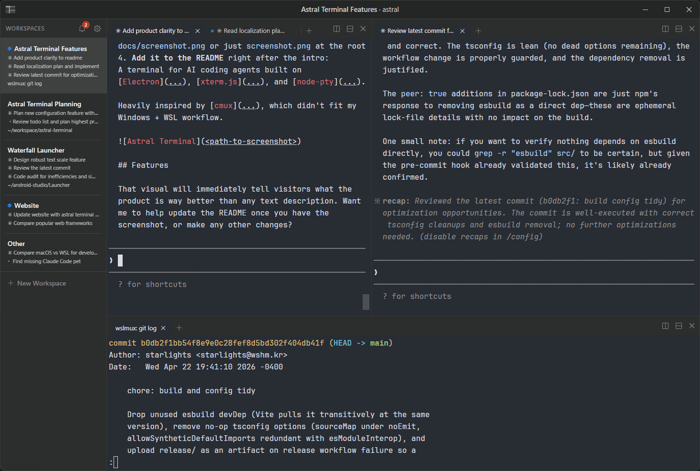

<h1> Astral Terminal</h1>

A terminal for running and supervising multiple AI coding agents in parallel, built on [Electron](https://www.electronjs.org/), [xterm.js](https://xtermjs.org/), and [node-pty](https://github.com/microsoft/node-pty).

Heavily inspired by [cmux](https://github.com/manaflow-ai/cmux), which didn't fit my Windows + WSL workflow.



## Features

✅ Done | 🚧 Partial | 🔲 Planned

| Status | Feature |
| :-: | --- |
| ✅ | First class support for Windows + WSL |
| 🔲 | Cross-platform support for Linux / MacOS |
| ✅ | Organized workspaces with split panes and tabs |
| ✅ | Configurable themes and notifications |
| ✅ | Notification inbox with jump-to-unread |
| ✅ | Built-in Claude Code and Codex hook notifications |
| 🔲 | Hook notifications for other agents |
| ✅ | Scrollback survives restarts |
| ✅ | Agent auto-resume on restarts |
| 🔲 | Scriptable CLI |
| ✅ | In-app browser |

## Getting started

Built and tested on Node 22. Building the CLI requires [Go](https://go.dev/) (`winget install GoLang.Go`).

```bash
npm install
npm run dev
```

`npm run dev` does not build the CLI. To test it in dev, run `npm run build:cli` first, otherwise the install is skipped with a warning.

## CLI

Astral installs an `astral` command to `~/.local/bin` in each WSL distro you open a terminal in. Run `astral --help` for usage, and see [docs/cli-protocol.md](docs/cli-protocol.md) for the protocol.

## Credits

- Font: [JetBrains Mono](https://www.jetbrains.com/lp/mono/)
- Icons: [Codicons](https://github.com/microsoft/vscode-codicons), [Simple Icons](https://simpleicons.org/) (via [react-icons](https://github.com/react-icons/react-icons))
- Terminal themes:
  - [One Half](https://github.com/sonph/onehalf)
  - [GitHub](https://github.com/primer/github-vscode-theme)
  - [Dracula](https://draculatheme.com/spec)
- In-app browser ad blocking: [Ghostery Adblocker](https://github.com/ghostery/adblocker)
